# Riyaz

A daily piano-practice coach for a MIDI keyboard (built for the Yamaha YPT-320) on macOS.
Riyaz is Hindi/Urdu for "daily practice".

## Screenshots

| | |
|---|---|
| 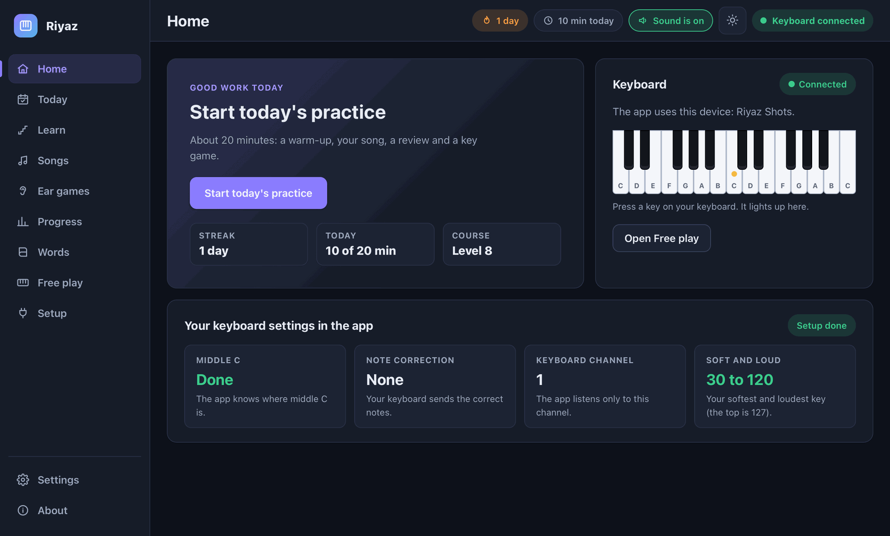 Home: start today's practice, streak, level and keyboard settings. | 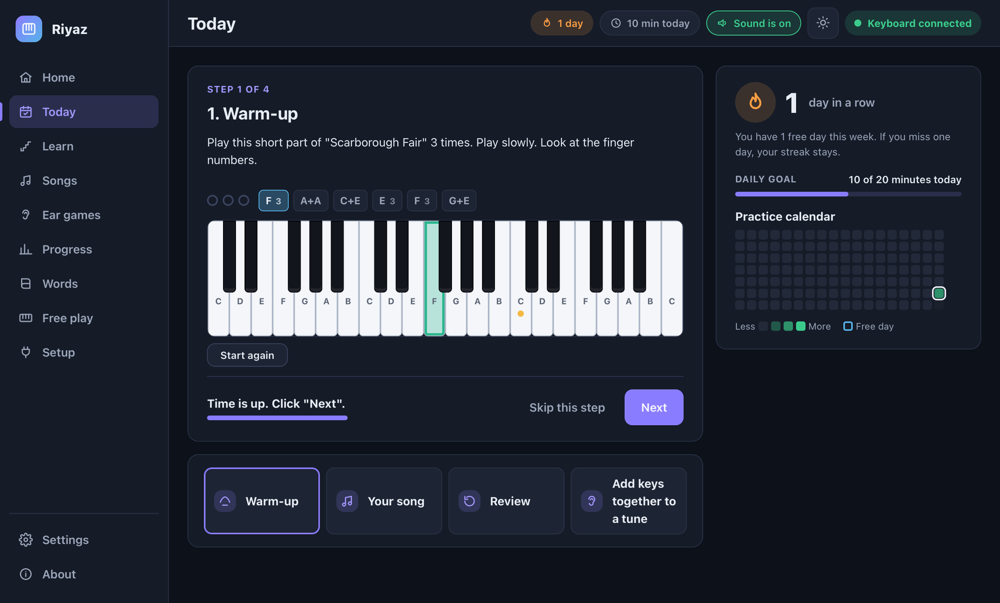 Today: the daily plan with a warm-up, your song, a review and an ear game. |
| 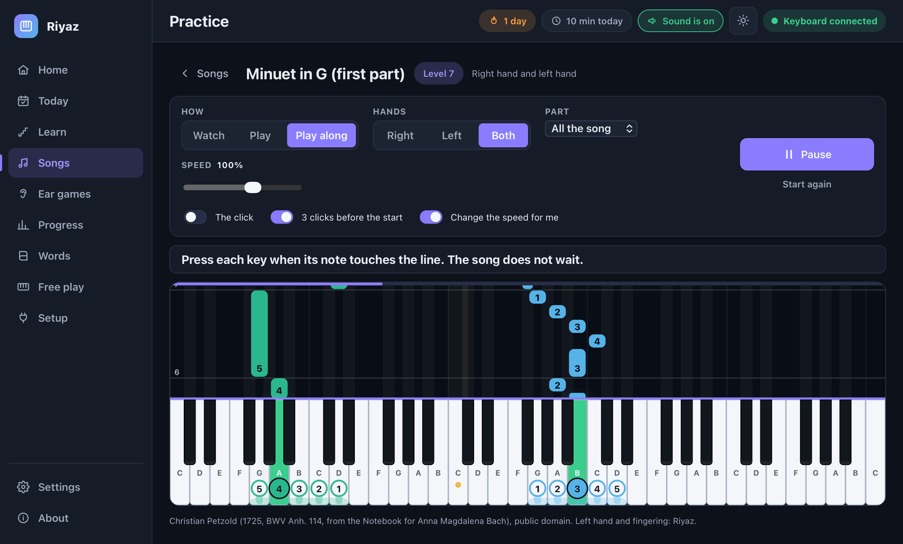 Play along: falling notes with finger numbers; the keys you press light up. | 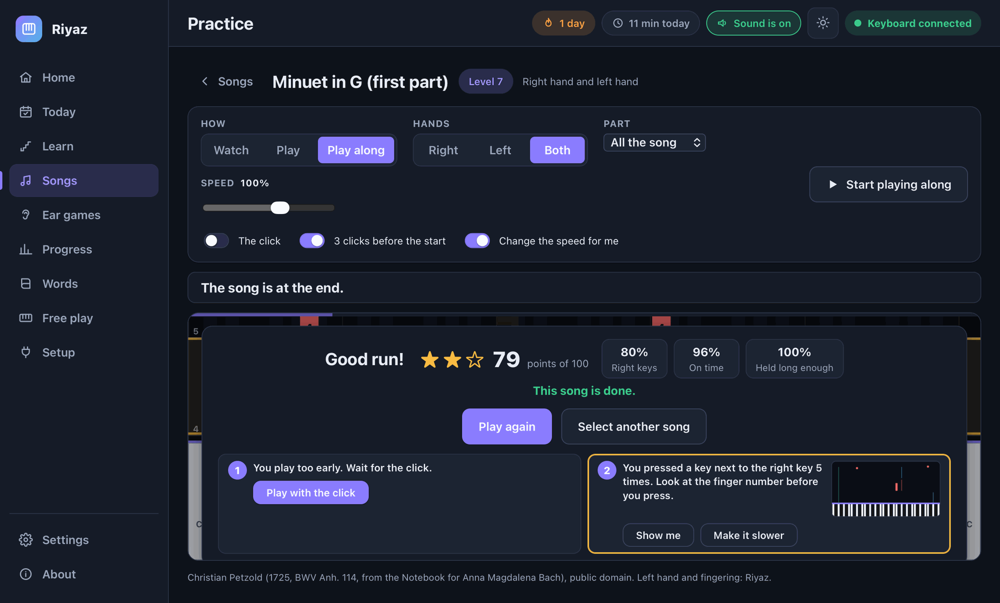 After a run: the score, stars and tips with a button to practice each one. |
| 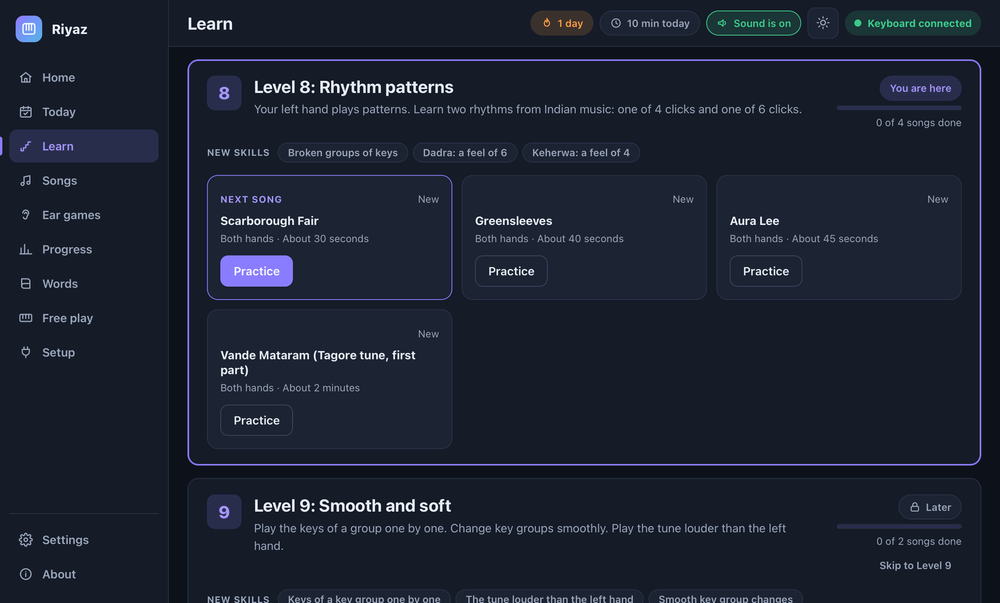 Learn: the course ladder from Level 1 to Level 10. | 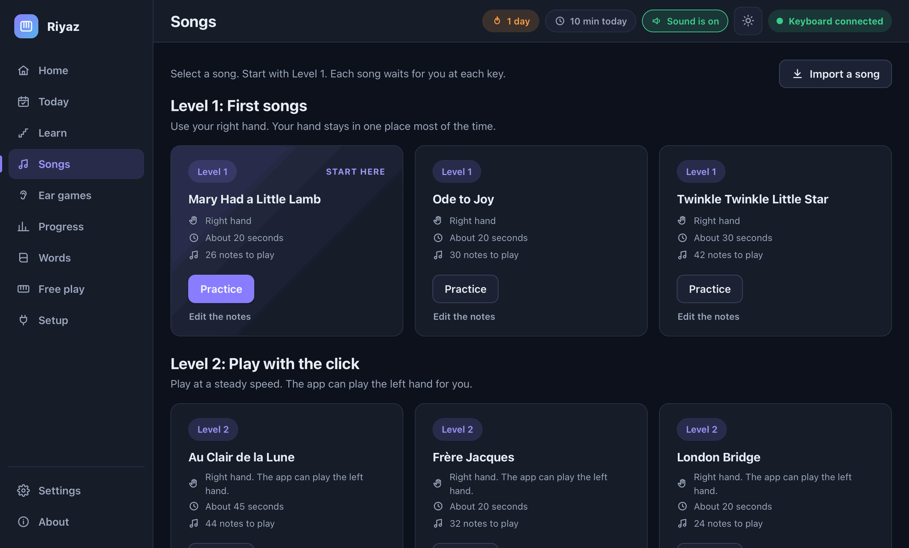 Songs: the built-in songs by level, and "Import a song". |
| 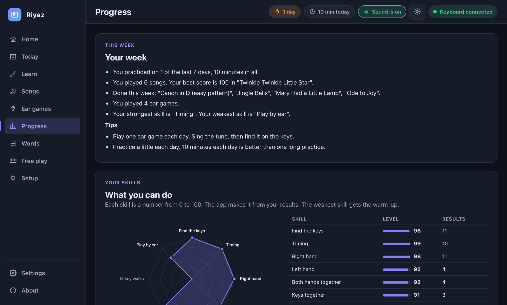 Progress: your week, your skills and your results. | 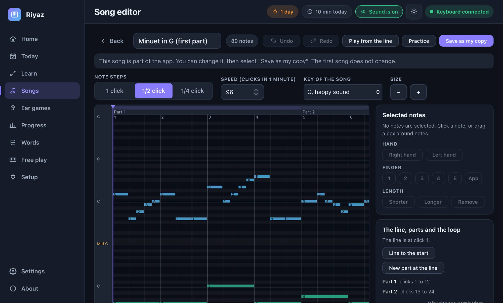 Song editor: change notes, fingers, hands and parts on a piano roll. |
| 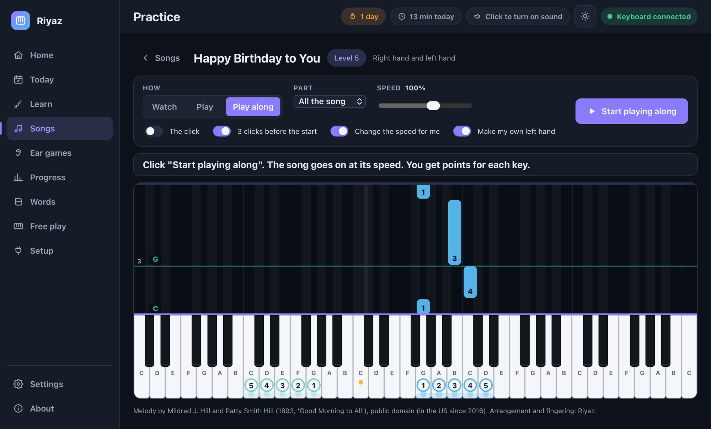 Lead-sheet mode: the tune and the key-group names; you make the left hand. | 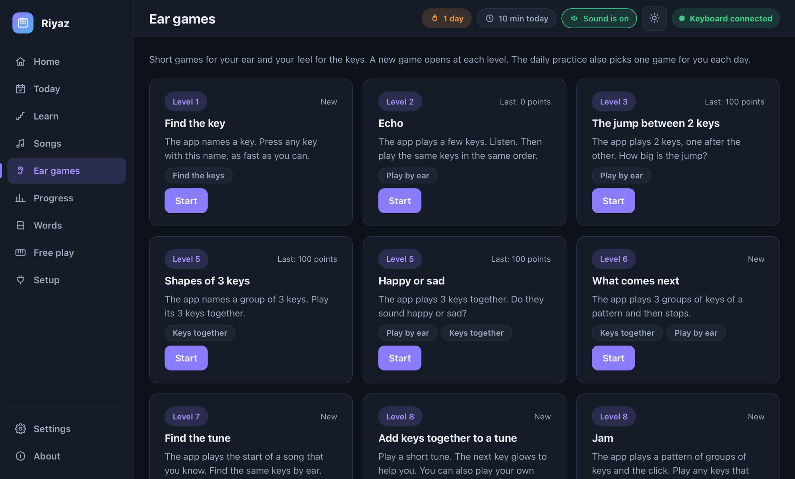 Ear games: short games for your ear, one more at each level. |
| 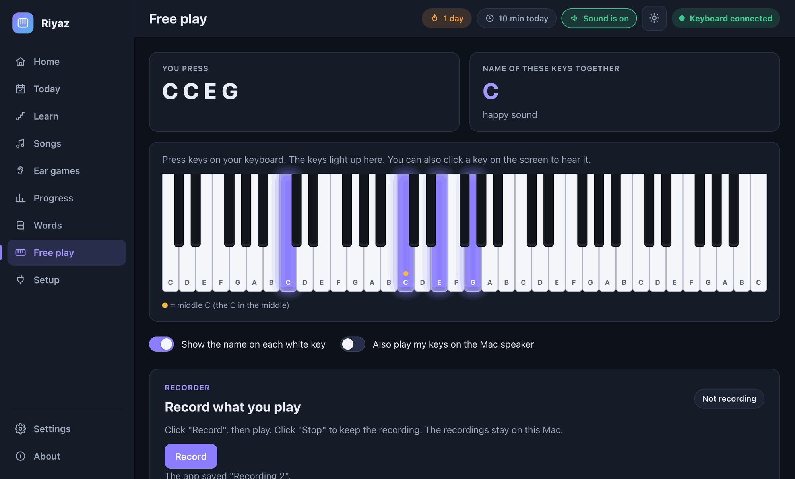 Free play: the keys you press, the name of the keys together, and a recorder. | 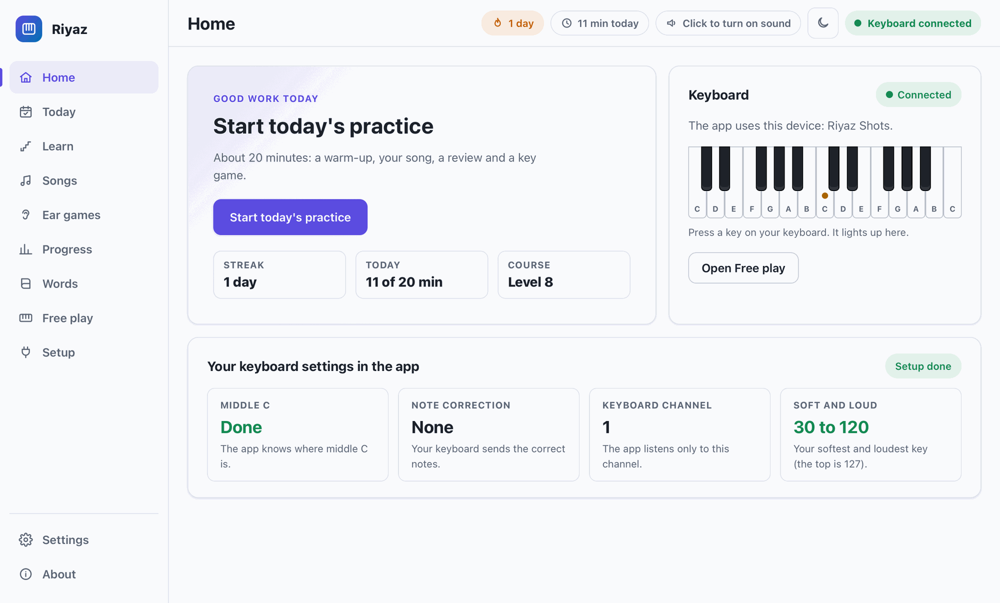 Home in the light theme. |
| 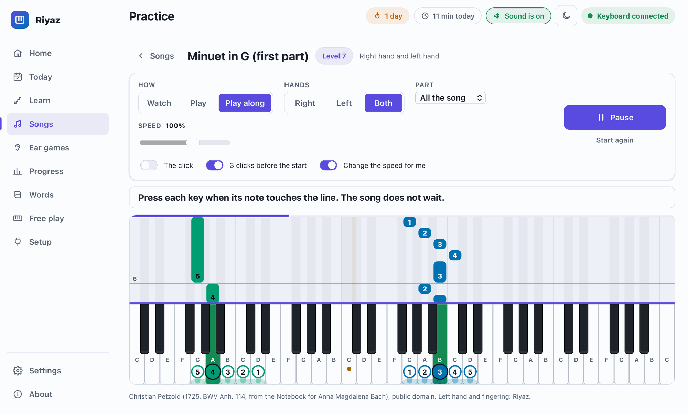 Play along in the light theme. | |

## Features

- **Keyboard setup:** MIDI connection, calibration, a live 61-key keyboard on the screen with note and chord names, and a Mac piano sound.
- **Songs:** built-in public-domain songs from Level 1 to Level 10, with falling notes, finger numbers and a hand outline.
- **Practice modes:** Watch, Play (the song waits for you) and Play along (the song does not wait), with hands, speed, the click, count-in and "Repeat a part".
- **Feedback:** points, stars, green/yellow/red keys, one tip at a time, findings after each run with "Show me", and automatic speed changes.
- **Today:** a daily session with a warm-up, your song, a review and an ear game, plus a streak, a daily goal and a practice calendar.
- **Learn:** keyboard basics and a song ladder from Level 1 to Level 10, with skill moments inside the songs and the music words you learned.
- **Ear games:** echo, the jump between 2 keys, happy or sad, what comes next, find the tune, add keys together, and jam.
- **Your own left hand:** lead sheets show only the tune and the chord names; you make the left hand. Also play a learned song in a new key.
- **Touch:** soft and loud tips, and an optional foot switch lesson (hidden when no foot switch is connected).
- **Import:** MIDI files (hand split, fingering, chords and a difficulty check) and audio files; easy versions of any song for your level.
- **Song editor:** change notes, fingers, hands and parts on a piano roll.
- **Free play:** a recorder that plays back and saves MIDI files.
- **Progress:** skills, results over time, and a weekly summary, with an optional local coach (Ollama, off by default).

## Install (release build)

```sh
curl -LsSf https://raw.githubusercontent.com/Darshan1510/piano-coach/main/install.sh | sh
```

The installer downloads `Riyaz-macOS-arm64.zip` and `Riyaz-macOS-arm64.zip.sha256` from the latest
GitHub release, checks the SHA-256, puts `Riyaz.app` in `~/Applications`, removes the quarantine
attribute from that app only (the app is not signed), and opens it. Options:
`--system` (install in `/Applications`), `--base` (the small app without audio import),
`--version v0.1.0`, `--zip FILE` or `--zip file:///path/Riyaz-macOS-arm64.zip` (a local file; the
checksum comes from `FILE.sha256` or `--sha256 FILE|HEX`), `--dest DIR`, `--no-open`.
A bad or missing checksum stops the install.

If macOS says the app is "damaged": run `xattr -dr com.apple.quarantine ~/Applications/Riyaz.app`.

## You need

- A USB-MIDI cable (for example Roland UM-ONE mk2). The YPT-320 has no USB port.
- The cable plug marked **OUT** goes into the keyboard's **MIDI IN**. The plug marked **IN**
  goes into the keyboard's **MIDI OUT**. The app setup screen shows a diagram.

## Project-local environment

Everything stays in this folder. Nothing goes into a global Python, Homebrew, or your shell profile.

| What | Where | Set by |
|---|---|---|
| Python 3.12 (uv-managed) | `.cache/python/` | `UV_PYTHON_INSTALL_DIR` (Makefile, `env.sh`) |
| uv package cache | `.cache/uv/` | `cache-dir` in `pyproject.toml` + `UV_CACHE_DIR` |
| Packages | `.venv/` | `uv sync` |
| PyInstaller cache | `.cache/pyinstaller/` | `PYINSTALLER_CONFIG_DIR` (Makefile, `env.sh`, and `Riyaz.spec` if not set) |
| Test data (removed after each run) | `.cache/test-data/` | `tests/conftest.py` |
| Raw downloads (Tone.js, samples) | `vendor-downloads/`, copied to `static/` | `make vendor` |

- `make <target>` always loads these values (exports at the top of the `Makefile`).
- For a manual shell, load them first: `. ./env.sh`
- `pyproject.toml` sets `python-downloads = "manual"`, so uv never downloads Python to a global folder.
  A plain `uv run main.py` uses the existing `.venv` and needs no exports.

## Run from source

```sh
make setup          # first time: Python 3.12 into .cache/python, packages into .venv
uv run main.py      # app window
uv run main.py --browser    # in the default browser
uv run main.py --server     # server only
PORT=8123 uv run main.py    # other port (default 8020; if busy, the app takes a free port)
RIYAZ_DATA_DIR=/tmp/riyaz-data uv run main.py   # other data folder (tests use this)
RIYAZ_PORT_FILTER="Riyaz Fake" uv run main.py   # see only MIDI ports whose name starts with this text
```

App data (settings, calibration): `~/Library/Application Support/Riyaz/`.

## Test without a keyboard

```sh
make test                                   # uv run pytest
uv run tools/fake_player.py --repeat 0      # virtual port "Riyaz Fake Keyboard" plays a tune
uv run tools/fake_player.py --shift 12      # as if OCTAVE/TRANSPOSE were +12
uv run tools/fake_player.py --noise         # also clock, start/stop, sysex, other channel
uv run tools/measure_latency.py             # key-to-app delay (app must run)
uv run tools/fake_player.py --song ode-to-joy                       # play a song's right hand in time
uv run tools/fake_player.py --song all --follow http://127.0.0.1:8020 --wrong 2
                                            # wait mode for every song in the running app (2 wrong keys each)
uv run tools/make_test_song.py              # 200-note test song in .cache/test-songs/
RIYAZ_EXTRA_SONG_DIR=.cache/test-songs uv run main.py   # show test songs in the Songs list
```

Songs are JSON files in `data/songs/` (format: `PLAN.md` 5.1; `start` and `dur` in beats).
Imported songs: `~/Library/Application Support/Riyaz/songs/<id>.json` with the original `<id>.mid`.

```sh
uv run tools/fake_player.py --song imported --hands RL --follow http://127.0.0.1:8020   # wait mode, imported songs
uv run tools/fingering_report.py            # automatic fingering vs the built-in songs
uv run tools/make_test_midi.py              # make the test MIDI files in tests/data/midi/
```

Course and daily session (the app must run):

```sh
uv run tools/fake_player.py --basics  http://127.0.0.1:8020            # do the keyboard basics
uv run tools/fake_player.py --session http://127.0.0.1:8020 --minutes 10   # a whole daily session
uv run tools/fake_player.py --autoplay http://127.0.0.1:8020 --until 600   # play what the window asks for
```

Play-along (the app must run):

```sh
uv run tools/fake_player.py --song all --mode play --follow http://127.0.0.1:8020   # exact timing: >= 98 points
uv run tools/fake_player.py --song twinkle-twinkle --mode play --follow http://127.0.0.1:8020 \
    --runs 3 --jitter-ms 150 --shift-ms -80 --slip-rate 0.1 --hard-bar 3 --seed 1   # errors -> findings
```

Ear games (the app must run; Level 8 opens all games):

```sh
uv run tools/fake_player.py --drill all --follow http://127.0.0.1:8020 --answer correct   # each game: 100 points
uv run tools/fake_player.py --drill jam --follow http://127.0.0.1:8020 --answer wrong     # low points
uv run tools/make_ladder_songs.py --check   # the Level 4-8 song files match the tool (hand-written notes)
```

With a real keyboard connected, test with the fake port only: start the app with
`RIYAZ_PORT_FILTER="Riyaz Fake Keyboard"` and `RIYAZ_DATA_DIR=<a temp folder>`.

Progress (sessions, song results, course, words, practice time) is in
`~/Library/Application Support/Riyaz/riyaz.sqlite3`.

`music21` is in the dev group only (test oracle). It is never in `Riyaz.app`.

### Audio import

The audio packages are in the uv group `audio` (basic-pitch with its CoreML model, librosa, numpy,
scipy; about 116 MB download, all in `.venv`). `uv sync` installs them. Without them
(`uv sync --no-group audio`) the app works; only audio import is off.

```sh
uv run tools/make_test_audio.py ode-to-joy /tmp/ode.wav     # a test WAV from a song (known notes)
uv run python -m riyaz.importers.audio_worker IN.wav OUT.json   # the worker alone (progress on stdout)
```

No demucs, torch or piano-transcription model (not installed; see `DECISIONS.md`).

## Build

```sh
make build-mac      # dist/Riyaz.app (uses Riyaz.spec), with audio import: about 290 MB
make build-mac-base # dist/Riyaz.app without audio import: about 45 MB
make release-zip VARIANT=full     # build + dist/release/Riyaz-macOS-arm64.zip + .sha256 (no upload)
make release-zip VARIANT=base     # the same for the base app: Riyaz-macOS-arm64-base.zip
make release-mac VERSION=v0.1.0   # release-zip, then tools/release.sh prints the gh command
```

Release steps (same flow as DocKit, by hand on this Mac):

1. Commit and push the code. Log in once with `gh auth login`.
2. Run `make release-mac VERSION=v0.1.0 VARIANT=full` (or `base`). It checks the zip and its checksum
   and prints the `gh release create` command.
3. Run the printed command (it starts with `RELEASE_YES=1`) to upload the zip and the `.sha256` file.
4. Test: `sh install.sh --version v0.1.0`.

## Clean

```sh
make clean          # remove build/, dist/, the zip, caches of pytest and Python
make distclean      # also remove .venv/, .cache/ (Python, uv, PyInstaller) and vendor-downloads/
```

`make distclean` removes everything that this project installed. To also remove the files that
macOS and the app write outside this folder:

```sh
rm -rf ~/Library/Application\ Support/Riyaz                 # app settings and calibration
rm -rf ~/Library/WebKit/local.riyaz.app ~/Library/Caches/local.riyaz.app   # web view data (Riyaz.app)
```

(When you run from source, WebKit uses `~/Library/WebKit/python3` and `~/Library/Caches/python3`.
Other Python apps with a pywebview window, for example DocKit from source, share these folders.)

## Credits

- Piano sound: Salamander Grand Piano by Alexander Holm, CC BY 3.0 (`static/samples/salamander/README.md`).
- Tone.js 15.1.22, MIT (`static/vendor/README.md`).
